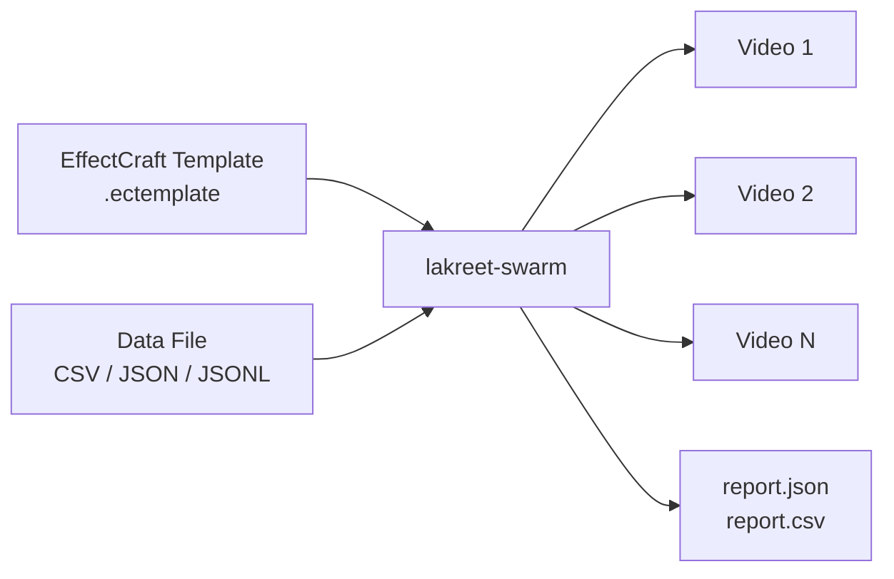

## How it works

1. **Design** your video in EffectCraft and mark the parts that change (text, opacity, etc.) as Essential Graphics controls.
2. **Export** the template as `.ectemplate`.
3. **Prepare** a data file (CSV, JSON, or JSONL) where each column matches a control name.
4. **Run** `lakreet-swarm render --template template.ectemplate --data data.csv` — one video per row.

## Plugins

<PluginIndex />

## Compatibility

| lakreet-swarm | EffectCraft | Node | OS |
|---------------|-------------|------|-----|
| 0.2.0 | 0.8.0 | 20, 22, 24 | Windows, Linux, macOS |

> **Independent project.** Not affiliated with the ArtCraft team or the EffectCraft project.