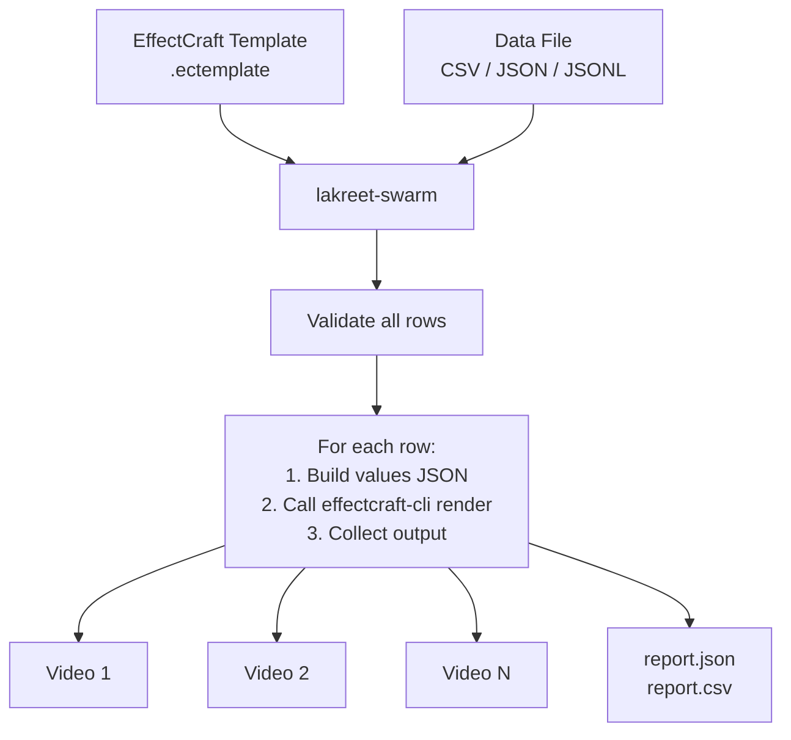

# How it works

lakreet-swarm orchestrates **batch rendering** by driving EffectCraft's CLI (`effectcraft-cli`) for each data row.

## The pipeline



## What lakreet-swarm does

| Phase           | Action                                                                        |
| --------------- | ----------------------------------------------------------------------------- |
| **1. Load**     | Read template (via `effectcraft-cli inspect`), read data file                 |
| **2. Validate** | Check every row against controls: types, required fields, media controls      |
| **3. Map**      | Apply column mapping (`lakreet.config.json` → `columns`)                      |
| **4. Select**   | Filter rows (`--only`, `--limit`, `--skip-existing`)                          |
| **5. Render**   | Sequential loop: write `.values.json` → spawn `effectcraft-cli render` → wait |
| **6. Report**   | Write `report.json`, `report.csv`; stream NDJSON if `--json`                  |

## What EffectCraft does

| Component                      | Role                                                             |
| ------------------------------ | ---------------------------------------------------------------- |
| `effectcraft-cli inspect`      | Extract manifest from `.ectemplate` (controls, media, comp info) |
| `effectcraft-cli render`       | Render one frame or full video from project + values JSON        |
| `effectcraft-cli render-frame` | Used by `preview` for quick PNG frames                           |

## Values JSON

For each row, lakreet-swarm writes a temporary `.values.json`:

```json
{
  "Source Text": "Budi",
  "Opacity": 75
}
```

This is passed to EffectCraft via `--values` flag.

## Render modes

| Command   | EffectCraft subcommand | Output                       |
| --------- | ---------------------- | ---------------------------- |
| `render`  | `render`               | Full video (MP4)             |
| `preview` | `render-frame`         | Single PNG frame at `--time` |

## Concurrency

**Default: sequential (1 job).** Each render waits for the previous to finish.

- Tested parallel speedup: **1.11× with 2 workers** on author's machine (below 1.5× threshold → no `--jobs` flag)
- Progress is an **estimate** — EffectCraft doesn't report frame progress when output is captured
- Varies significantly by machine, template complexity, codec

## Exit codes

| Code | Meaning                                       |
| ---- | --------------------------------------------- |
| 0    | All succeeded                                 |
| 1    | At least one render failed                    |
| 2    | Usage error (bad flags)                       |
| 3    | Invalid data (validation failed)              |
| 4    | `effectcraft-cli` not found                   |
| 5    | Template unreadable                           |
| 130  | Interrupted (Ctrl+C) — partial report written |

## Next steps

- [Templates](/swarm/concepts/templates) — .ectemplate anatomy
- [Validation](/swarm/concepts/validation) — why validate all rows first
- [Performance](/swarm/concepts/performance) — benchmarks & limits
- [CLI reference](/swarm/reference/cli/render) — all render options
